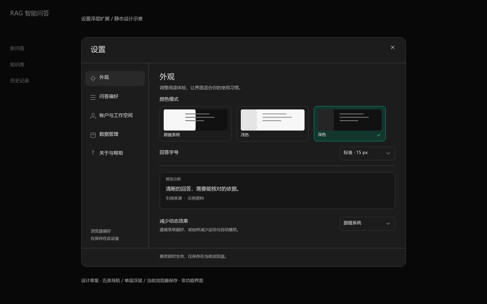

# 设置浮层扩展：设计规划

> 核对日期：2026-10-27。后续状态：用户已授权实现首版，契约、进度与最终证据以 [settings-modal-preferences](../../openspec/changes/settings-modal-preferences/design.md) 及其任务/实施记录为准。
> 本文保留最初设计理由与实施前事实快照，静态稿不代表功能验收；前一工作空间任务保留待验收，未据此接受或归档。

## 💡 30秒人话设计主旨

现在设置浮层只能切换主题、查看资料，用户还不能调整阅读大小、发送快捷键，也不清楚哪些偏好能保留。我们保留熟悉的浮层，把内容组织成“外观、问答偏好、账户与工作空间、数据管理、关于与帮助”五类，优先补齐日常阅读与操作所需的设置。个人偏好即时生效并只保存在当前浏览器，账户和工作空间继续使用服务端真实资料；设置不会改变检索、引用有效性或问答请求方式。

## 1. 静态示意与阅读顺序

先看布局和信息层级，再审阅设置项、保存规则及实施顺序。示意中的回答是设计样例，不是实际模型输出；图片里的控件不能操作，也不能证明浏览器适配或无障碍通过。

- [桌面深色：外观](assets/settings-modal/desktop-dark.png) / [可编辑 SVG](assets/settings-modal/desktop-dark.svg)。
- [桌面浅色：问答偏好](assets/settings-modal/desktop-light.png) / [可编辑 SVG](assets/settings-modal/desktop-light.svg)。
- [窄屏深色：外观](assets/settings-modal/mobile-dark.png) / [可编辑 SVG](assets/settings-modal/mobile-dark.svg)。

## 2. 当前事实与能力边界

| 状态 | 已核对的事实 | 依据或后续处理 |
| --- | --- | --- |
| `confirmed` | 正式设置只有“常规、个人资料”；支持 system/light/dark，主题写入当前浏览器；已有 Escape、背景 inert 与关闭后焦点归还逻辑。 | [SettingsModal.vue](../../rag-frontend/src/components/settings/SettingsModal.vue)、[theme.ts](../../rag-frontend/src/stores/theme.ts)。这只是代码事实，本轮未重跑交互验收。 |
| `confirmed` | 正式问答默认同步，流式通过输入框高级选项显式选择；当前 Enter 发送，Shift+Enter 换行。 | [ChatPanel.vue](../../rag-frontend/src/components/chat/ChatPanel.vue)。 |
| `confirmed` | 来源采用原生 details，默认收起；只有当前允许展示的 citations 才能进入来源组件。 | [AnswerSources.vue](../../rag-frontend/src/components/chat/AnswerSources.vue)、[长期能力契约](../../openspec/specs/rag-system/spec.md)。 |
| `confirmed` | 登录粒子动效已经读取系统 prefers-reduced-motion；本地手动减少动效偏好尚未接入。 | [LoginParticleScene.vue](../../rag-frontend/src/components/common/LoginParticleScene.vue)、[loginParticleMotion.ts](../../rag-frontend/src/utils/loginParticleMotion.ts)。 |
| `partial` | 账户与工作空间只读上下文已经接入代码，前一 change 仍待用户接受；合成证据不等于真实数据库、设备或生产隔离验收。 | [前一任务实施记录](../../openspec/changes/workspace-context-visibility/implementation-review.md)。 |
| `planned` | 下文列出的新字号、快捷键、来源展开偏好、本地重置和设置五类导航。 | 本规划提出的首版范围，尚无实现或测试结论。 |
| `unknown` | 实体设备、屏幕阅读器、系统缩放、真实运行时构建元数据的最终展示效果。 | 实现阶段分别核查，不使用示意稿补证。 |
| `out_of_scope` | 编辑账户、改密、密钥管理、组织切换、成员邀请、计费、模型配置、检索参数、云端偏好同步。 | 这些需要独立能力或契约，首版没有占位按钮。 |

## 3. 信息结构与入口

| 顺序 | 栏目 | 用户能解决什么问题 | 首版内容 |
| --- | --- | --- | --- |
| 1 | 外观 | 阅读大小是否舒服，界面是否需要减少运动？ | 三张主题卡、回答字号、静态阅读预览、减少动态效果。 |
| 2 | 问答偏好 | 如何发送问题，如何查看来源？ | 发送快捷键、来源片段默认展开方式、现有回答方式的简短说明。 |
| 3 | 账户与工作空间 | 我以什么身份使用，资料属于哪个组织？ | 真实用户名、邮箱、只读工作空间及状态，退出登录。 |
| 4 | 数据管理 | 偏好存在哪里，如何恢复，如何查看历史？ | 本地保存范围说明、重置本地偏好、打开历史记录。 |
| 5 | 关于与帮助 | 如何使用现有能力，发生中断时该怎么看？ | 简短使用说明、快捷键、版本信息的真实来源与缺失降级。 |

“设置”入口默认打开外观；“个人资料”和“查看归属”继续直达账户与工作空间。保留旧 initialTab 的 general→appearance、profile→account 映射；既有 security/apiKey 兼容参数落到外观，不制造未接通页面。旧组件入口与正式 AppShell 共用同一设置状态与偏好源。

五个栏目足以浏览，首版不加设置搜索。栏目内以小标题和组间留白组织信息，不把每行包成独立大卡片。正常项目采用“左侧名称与说明、右侧控件”，较长说明在控件下方换行。

## 4. 浮层布局与视觉

沿用现有中性灰、绿色强调、项目字体和 Lucide 图标，不引入新视觉体系或依赖。主题卡用本产品的侧栏、回答和输入区缩略示意，选中时同时显示边框、勾号和选项文字。

| 区域 | 设计约束 |
| --- | --- |
| 桌面容器 | 建议宽度上限 960 CSS px，距离视口每侧至少 16 px；圆角沿用 18 px。高度随内容增长，上限为视口高度减 32 px，不固定文字行高。 |
| 标题栏 | 保留“设置”和关闭按钮；内容滚动时仍能关闭。关闭按钮桌面命中区至少 40×40 px，触屏至少 44×44 px。 |
| 左侧导航 | 约 180–200 px，垂直排列五项；当前项有背景和 aria-current。栏目名允许换行，不用省略号隐藏关键信息。 |
| 右侧内容 | 正常内边距 28 px；组内约 12–16 px，组间约 28–32 px。只有内容区滚动，导航和标题不随长内容离开。极矮视口允许整体回退滚动，保证关闭可达。 |
| 窄屏浮层 | 当导航和内容不能并列时改为单列，初始候选断点 45rem，实际由内容回流验证决定。仍是同一 modal，无新路由；保留约 8 px 外边距、标题及原生“设置分类”下拉框，下方内容独立滚动。 |
| 浮层底部 | 保留简短保存说明，无总“保存”按钮；它不应遮挡最后一行，窄屏考虑 safe-area。 |

320 CSS px 和 200% 缩放时允许设置行上下排列、预览卡换行，禁止五个栏目挤成一排。背景业务页锁定滚动，浮层设置 overscroll-behavior: contain。实现后测试 1440×900、1024×768、390×844、320×640 和矮窗口；图片宽度不作为适配通过证据。

## 5. 首版设置项与默认值

### 5.1 外观

| 项目 | 控件、选项与默认值 | 生效范围与说明 |
| --- | --- | --- |
| 颜色模式 | 原生 radio 预览卡：跟随系统／浅色／深色；默认跟随系统。 | 即时作用于全站和 Teleport 浮层，继续使用现有 theme store 与 theme 键，兼容旧值。 |
| 回答字号 | 原生 select：小 14 px／标准 15 px／大 17 px；默认标准，与当前回答正文 15 px 对齐。 | 仅调整回答阅读区的正文及相对标题、列表、表格文字；按钮、输入框和导航保持原尺寸。代码保持既有独立字号，长代码仍在自身滚动。使用 rem 或相对 token，不阻止浏览器缩放。 |
| 阅读预览 | 一段明确标注“预览示例”的静态短答案及一条来源样式。 | 与字号即时联动，不发 ask，不保存为历史，不冒充真实回答。 |
| 减少动态效果 | 原生 select：跟随系统／始终减少；默认跟随系统。 | 生效条件为“系统要求减少，或用户选择始终减少”。减少时登录粒子停止连续运动和自动播放，移除滑动、缩放等非必要过渡；加载和错误仍通过文字/静态图形表达。 |

用户选择主题后预览卡与整个浮层同步变色。主题单选卡的完整区域可点击，不能依赖 1 px 隐藏输入的文字激活时序；选中状态和键盘焦点必须各自清楚。

### 5.2 问答偏好

| 项目 | 控件、选项与默认值 | 生效边界 |
| --- | --- | --- |
| 发送快捷键 | select：Enter 发送／Ctrl 或 ⌘ + Enter 发送；默认前者。 | Enter 模式下 Shift+Enter 换行；组合键模式下 Enter 换行、Ctrl+Enter 或 Meta+Enter 发送。输入框提示同步更新，发送按钮始终可用。 |
| 来源片段 | select：默认收起／默认展开；默认收起，与当前一致。 | 对之后挂载的来源卡采用该初始状态；已经手动展开/收起的卡不因打开设置或字号变化被重置。历史详情新挂载时同样采用该偏好。 |
| 回答方式 | 说明文字：“同步／流式可在输入框高级选项中选择。” | 没有第二套开关，不持久化选择，不改变默认同步。 |

中文输入法正在组合文字时 Enter 不发送，检测 isComposing 并兼顾目标浏览器的组合结束边界；长按、重复按键、请求进行中不得造成重复发送。修改快捷键不会自动提交草稿。

来源偏好只调整允许展示的卡片是否展开；不能让未完整结束、停止接收、非 ANSWER 的流式文本获得来源，也不触发额外检索。设置变化不改变已有 ANSWER/no-answer/citation/terminal 判定。

### 5.3 账户与工作空间

沿用已有 auth/session context 作为唯一来源，不额外读取一套资料、不解析 Token 补值、不在 localStorage 保存用户名或组织名。资料顺序为头像字母、用户名、邮箱、所属工作空间与可见范围说明。

- loading：保留稳定区域，显示“正在读取工作空间”。
- ready：展示真实名称；长名完整换行，缺失邮箱显示“未提供”。
- error：显示“工作空间资料暂不可用”及现有共享重试，不解释成“没有工作空间”。
- 失效或身份变化：继续服从原会话清理和重新登录流程，迟到响应不能回填旧身份。

“退出登录”复用 [useAuth](../../rag-frontend/src/composables/useAuth.ts) 的单次请求和会话清理，进行中保留文字并禁用重复点击；沿用现有 confirmed/unconfirmed/superseded 提示规则，不把本地清理说成服务端已确认。保留侧栏原入口，两处共用状态。退出后浮层随业务壳卸载，本地显示偏好仍按浏览器保留。

### 5.4 数据管理

第一组标题“当前浏览器”，说明：“外观和操作偏好保存在当前浏览器。同一浏览器中的其他账号也会沿用，不会同步到其他设备。”不展示账号信息或偏好占用字节等无必要数据。

“重置本地偏好”点击后，在本栏目内展开确认区，列出主题、回答字号、减少动态效果、发送快捷键、来源展开五项及默认值。提供“取消”和“确认重置”，焦点进入确认区；取消归还触发按钮，Escape 优先取消确认，再次 Escape 才关闭浮层，避免两个 modal 嵌套。

确认只复位本功能拥有的偏好：theme 回到 system，其余回到本表默认值；不调用 localStorage.clear()，不清会话凭据、问答草稿、历史、知识库或其他功能存储。内存立即恢复；持久化失败则说明“当前已恢复默认，但浏览器暂无法保存，刷新后可能恢复旧设置”，不报告完整成功。

第二组标题“历史记录”，提供普通链接“打开历史记录”，复用 /history。正常点击先关闭设置再导航，支持原生新标签打开；不在设置内另做列表或删除入口，不自动删除记录。

### 5.5 关于与帮助

首版内嵌短说明：如何选择知识库、发送与换行、展开来源、查看执行轨迹、如何理解停止接收与中断。说明以现有单条问答为准，不声称支持多轮会话。帮助只读，不触发 ask 或外部请求。

版本从构建时可用的 package 元数据获取，并明确为“前端版本”；若版本仍为占位值则显示“开发版本”，缺失时显示“版本信息未提供”。只有构建流程已经提供短 revision 或构建时间时才展示，不在浏览器调用 Git、不新增联网检查或依赖。不把前端版本当作后端或模型版本，不添加没有地址的反馈按钮。

## 6. 保存方式与失败处理

用户每次选择即生效，关闭或点击遮罩不撤销选择。浮层显示“更改即时生效，仅保存在当前浏览器”。没有待保存表单或关闭确认；只有重置具有行内确认。

| 数据 | 唯一所有者与拟议保存方式 | 读取、失败与迁移 |
| --- | --- | --- |
| theme | 沿用现有 useThemeStore 与 theme 键。 | light/dark/system 保持兼容；无效值回 system，写失败本次内存仍生效。 |
| 回答字号、减少动效、发送键、来源展开 | 拟新增 usePreferencesStore；使用 rag.ui.preferences.v1，仅保存版本及枚举，不含身份和业务数据。 | 字段独立校验，无效字段回默认，损坏 JSON/不支持版本回默认；异常只显示固定提示，不输出原始存储值。 |
| 当前栏目与栏目滚动位置 | 仅在一次打开期间保留；重新打开按入口决定。 | 不持久化，不记录用户点击轨迹；切换栏目不把焦点扔到背景。 |
| 账户和工作空间 | 沿用现有内存上下文。 | 不新增持久化或 API，加载失败不影响本地外观设置。 |

拟议 schema：`{ version: 1, answerTextSize: 'small' | 'standard' | 'large', motion: 'system' | 'reduce', sendKey: 'enter' | 'modifier-enter', sources: 'collapsed' | 'expanded' }`。首版不做多标签页实时同步，每个标签初始化读取，保存后其他标签刷新生效；这项限制写入帮助，避免增加隐式状态覆盖。

写失败时使用稳定的 role=status 区域说明“本次更改已生效，浏览器暂无法保存，刷新后可能丢失”，不在每次选择重复弹出 toast；主题和其他偏好分别记录存储可用性，成功恢复只能清除对应故障。记录只包含安全枚举，不记录用户提问、组织、凭据或原始异常。

## 7. 组件与接线计划

这是实现阶段候选分工，不是本轮已创建的生产文件。实际拆分在 OpenSpec design 中确认后维护，避免本规划与实现进度双份更新。

| 位置 | 预期职责与限制 |
| --- | --- |
| SettingsModal | 继续拥有 dialog、关闭、焦点管理、分类及行内确认生命周期；可按栏目拆小组件，避免集中大量条件分支。 |
| theme / preferences store | theme 保持唯一主题来源；preferences 负责四项新偏好及校验/内存降级，不混入 auth。 |
| variables / global / 组件样式 | 使用原有 token 添加阅读字号和减少动效作用域；不全局缩放所有控件，不重写整套样式。 |
| ChatPanel / AnswerSources | 仅接快捷键与来源初始展开、回答字号；保持输入框尺寸、知识库选择、请求参数、草稿、滚动跟随和历史只读语义。 |
| LoginParticleScene / motion 工具 | 把系统与本地减少动效合成为一个有效信号；保持现有离屏停止、卸载清理、手动暂停与静态回退。 |
| AppSidebar / AppShell / 兼容入口 | 保留现有打开方式，资料直达映射及关闭后焦点归还；不创建设置路由。 |

偏好初始化应早于首次相关界面绘制，避免主题或动效先闪动再停止；系统监听应有唯一生命周期并在卸载清理。页面运行中打开设置、切换字号或关闭设置，不得卸载 ChatPanel、重连 SSE、重发 ask 或清空草稿。

## 8. 键盘、无障碍与状态

采用 better-layout 的内容回流和分组规则，以及 better-accessibility 的原生控件、命中区、焦点与减少动效规则；只应用于现有浮层，不启用图片生成、营销页或网站发布流程。

- 分类继续采用 nav 下 button 与 aria-current，首版不伪装成缺少方向键规则的 tablist；窄屏分类使用有 label 的原生 select。
- 主题使用 fieldset/legend 和同名 radio，方向键、Space、标签点击均由原生控件支持；装饰预览不进入可访问名称。
- dialog 保留名称、aria-modal、背景 inert；打开焦点移入，Tab 循环覆盖当前可见且可用的 button、a、input、select 等控件，不能仅依赖旧 button/select 查询。
- 关闭、切换、展开确认、退出中、资料失败均有可读名称与状态；焦点环至少 2 px，选中不只靠绿色，错误与保存提示不只靠颜色。
- 关闭回到原触发器；触发器因移动抽屉关闭而消失时，回到仍存在的侧栏入口；退出导致业务壳卸载时，服从登录页焦点流程。
- 修改主题与偏好不读屏播报整页；持久保存错误使用稳定 polite 状态区。工作空间错误不重复触发全局 alert。
- 正文颜色、说明文字、焦点环与控件边界在实际深浅背景测量；高对比模式使用系统颜色。200% 缩放、长名称、键盘和屏幕阅读器分别记录，不能用静态图验收。

## 9. 实施顺序与验收

### 9.1 前置条件与单焦点切片

当前只审阅本文和示意。前一活动任务接受或获准挂起后，才能切换活动指针；实施前创建 settings-modal-preferences 的 proposal/design/tasks/spec delta，尤其核对“首批设置仅只读资料与外观”的 baseline 如何扩展。后续实现状态以该 change 为唯一事实源，本文保留设计理由。

| 切片 | 交付内容 | 完成条件 |
| --- | --- | --- |
| S1 | 五类浮层结构、旧入口映射、深浅与窄屏、主题预览卡。 | 所有栏目可达，关闭和焦点可用，已有主题和工作空间状态保留。 |
| S2 | 偏好校验/降级与初始化、回答字号、减少动效、静态预览。 | 刷新保留、坏存储降级、系统减少优先、粒子生命周期正确，业务内容不丢失。 |
| S3 | 发送键和来源展开接线。 | IME 不误发、两种快捷键可用、无重复请求、未完整终态不显示来源。 |
| S4 | 本地重置、历史入口、账户退出接线和内嵌帮助。 | 仅清自有偏好、取消无副作用、失败诚实提示、正常历史与退出语义不变。 |
| S5 | 聚焦回归、正式构建、浏览器矩阵和证据审阅。 | 对下表逐项给出通过/失败/未验证，不靠 build 替代视觉。 |

### 9.2 必验场景

| 场景 | 应看到的结果 | 证据类型 |
| --- | --- | --- |
| 从设置、资料与工作空间入口打开 | 默认外观或直达账户；关闭恢复合理焦点。 | 浏览器键盘与指针。 |
| 三主题、同页浮层及跨路由 | 主题一致；旧 theme 值兼容，手动选择不被系统覆盖。 | 聚焦测试与浏览器。 |
| localStorage 读写抛错、坏 JSON、非法枚举 | 页面可用，单字段回默认，本次内存生效，提示保存受限。 | 合成故障测试。 |
| 中文 IME、组合结束 Enter、两套发送键、长按与发送中 | 草稿与换行正确，每次明确发送最多一次，无意外 ask。 | 合成接口浏览器与聚焦测试。 |
| 生成中打开设置、调整字号、关闭 | 不重连、不重发、不清草稿；上翻阅读不被强拉到底。 | 封闭 SSE/同步夹具，检查请求计数。 |
| 默认来源展开、用户手动收起、历史重新挂载 | 初始化遵从偏好，已操作卡片保持选择。 | 浏览器。 |
| 非 ANSWER、断流、停止接收 | 即使设置展开也不展示受限来源，不冒充完整回答或服务端取消。 | 原终态回归与浏览器。 |
| 系统减少动效、手动减少、暂停、离屏、重挂 | 系统减少优先，无循环动画或监听泄漏，静态与表单可用。 | 动效聚焦测试与浏览器。 |
| 重置取消、确认、写失败 | 不改变凭据/历史/草稿/知识库；保存部分失败仍如实告知。 | 哨兵存储与浏览器。 |
| 资料 loading/error/重试/长名/换号迟到响应 | 沿用共享状态与身份隔离，名称可读，不显示旧账号信息。 | 前一状态测试复用并补接线回归。 |
| 深浅 × 1440/1024/390/320 与矮窗口、200% 缩放 | 栏目、最后一行、关闭均可达，无页面横向溢出，嵌套滚动不影响背景。 | 实际浏览器截图与操作；静态稿不替代。 |
| 读屏与强制颜色模式 | 名称、角色、状态及焦点可辨识。 | 实机/可用辅助技术；不可用时明确未验证。 |

实现阶段运行有意义的偏好/输入/终态聚焦回归，相关前端全量回归，以及包含 vue-tsc 的 FrontendBuild；最后执行 DocAndScope 和范围检查。无 Java/Python 业务改动时不运行无关后端/评测测试。浏览器采用零代理的封闭数据夹具，不调用真实 ask/embedding/rerank/judge/provider，不通过设置变更增加依赖或服务。

## 10. 后续候选与本轮边界

第二批候选为回答内容宽度、少量强调色预设、执行轨迹视图偏好。它们需要单独检查回答/输入区对齐、主题对比和视图状态，首版不加入空控件。回答方式持久化、默认知识库、通知、历史导出与保留策略、账户编辑、API 密钥、模型/provider 管理及云端同步另行设计。

本轮只交付本文、三组静态示意、导航入口和简短日志；不修改生产源码、baseline 或当前活动指针，不暂存、提交、push、部署或接受/归档。真实业务调用和数据出站均为 0。规划文档与图片的检查记录保存在[规划检查](设置浮层扩展-规划检查.md)；图像无交互，真实浏览器、设备和读屏效果留待实现验收。

## 决策记录

### D1：继续使用同一个浮层

- **当时面临哪几个选择？** 可以另建设置路由，也可以扩大现有浮层，保留原打开和关闭流程。
- **最终选了谁及理由？** 用户明确选择沿用浮层，因此采用五类导航、固定标题和可滚动内容区；窄屏仍在同一 dialog 内回流，避免切走正在阅读的问答。
- **其他方案的代价是什么？** 独立路由更适合未来复杂管理，但会增加导航、草稿和返回路径处理；本轮没有这项需求。

### D2：即时生效并仅在浏览器保存

- **当时面临哪几个选择？** 使用总保存按钮、自动保存到浏览器，或新增后端做账号同步。
- **最终选了谁及理由？** 选择浏览器即时保存，延续现有主题方式，让字号和动效可以直接观察；存储失败仍允许本次使用，且明确告诉用户限制。
- **其他方案的代价是什么？** 总保存需要维护草稿与关闭撤销，云端同步需要新接口和账号偏好模型；本地保存的代价是不能跨设备，并会被同一浏览器的不同账号共用，界面需明确说明。

### D3：系统减少动效优先

- **当时面临哪几个选择？** 提供“跟随／开／关”三态并允许强制动画，或只提供“跟随系统／始终减少”。
- **最终选了谁及理由？** 采用两项，系统或用户任一要求减少就停止连续运动，避免用户在应用里误把系统保护关掉。
- **其他方案的代价是什么？** 三态更灵活，但“关闭减少”容易让用户误解，且增加与现有系统监听的冲突。

### D4：设置只管理操作与阅读偏好

- **当时面临哪几个选择？** 把模型、TopK、流式默认等一起放入设置，或只补齐不会改变请求含义的偏好。
- **最终选了谁及理由？** 首版采用后者，保留默认同步、显式流式、引用有效性和历史只读约定，便于验证效果且不影响既有评测比较。
- **其他方案的代价是什么？** 全部开放需要重新定义成本、权限、失败与默认行为，不能以增加前端控件代替契约设计。

### D5：分类使用原有导航，重置使用行内确认

分类保持 nav/button，窄屏使用原生 select；重置在栏目内确认。这沿用已有平台控件和单层 modal，减少嵌套焦点管理；代价是首版没有横向 tabs 和快捷设置搜索，五类内容仍可直接找到。
