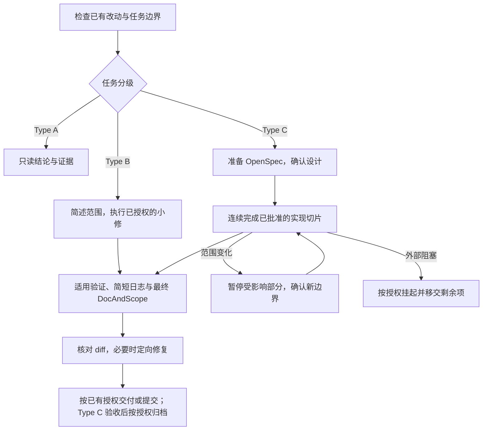

# Vibecoding Playbook · 个人 AI 协作开发手册（v2.1）

> 适用项目：Enterprise RAG QA System（及后续同类个人项目）
> 配套治理：`AGENTS.md`（Type 分级）、`openspec/`（change 生命周期）、`.ai/ACTIVE_TASK.md`（唯一活动指针与挂起表，≤25 行）、`.ai/AGENT_LOG.md`（滚动热日志，≤200 行）、`.ai/GOTCHAS.md`（避坑备忘录，≤100 行）
> 文档性质：长期沿用的"协作方法论"，与 `iteration-blueprint.md`（方向）互补——蓝图管"往哪走"，本手册管"怎么走得稳、上下文不腐化"。
> 状态日期：2026-10-22（v2.1 按风险减负）；协作硬规则以 [`AGENTS.md`](../../AGENTS.md) 为准，本手册提供执行路径与示例。

## 0. 一句话原则

把人工注意力留给方向、契约和风险变化：已授权的小修直接完成，重大变更先审设计；同一事实只维护一份，验证与授权在适用范围内复用。

## 1. 核心工作流（写入任务）

写操作保持单焦点，只读调研可并发；切片串行不等于每个切片都要重新审批：

- **① 开工前置**：检查 Git 状态，识别并隔离已有改动；读取 `.ai/ACTIVE_TASK.md` 与 `.ai/GOTCHAS.md`。需要时记录 HEAD 作比较锚点，工具链不明时运行 `Preflight`。
- **② 按风险确定执行方式**：Type B 简述范围后执行；Type C 先准备并确认 `proposal/design/tasks/spec delta`。沿用已有提交责任，无授权时默认用户手动提交，无需为此另问一次。
- **③ 执行**：在已授权范围内连续完成可验证切片；只有范围不清、风险升级、授权不足或用户要求逐段审查时，才暂停受影响部分。Type C 的子任务进度只在 `tasks.md` 维护。
- **④ 验证与记录**：运行适用测试，每个可验证切片追加一条简短日志，最终文件状态运行 `DocAndScope`；专项证据已有记录时链接引用，新发现的可复用陷阱才写入 `GOTCHAS.md`。
- **⑤ 范围复核**：Agent 检查 diff 是否符合授权范围、是否保留已有改动；用户按约定审查，不为每次小修新增人工等待。
- **⑥ 交付与提交**：获得提交授权时将本次改动与日志同次提交，否则保留改动并给建议 message。Type C 完整验收后按已有归档授权收口；未覆盖归档时再确认。归档时合入已接受 delta 并释放活动指针，不做 hash 补录提交。

## 2. Type 分级速查

- **Type A（只读）**：复核、扫描、审计、教学。不建 change 目录、不改代码、不改 `ACTIVE_TASK.md`。
- **Type B（小范围维护）**：已有契约内的局部修复、测试隔离、文案/样式或治理维护。不建 change；明确的小修不重复等确认，完成后验证并写简短日志。
- **Type C（重大变更）**：按 `AGENTS.md` 第 4 节判断能力、契约、基础设施、指标口径和隔离/回滚风险，走完整 OpenSpec 生命周期。提交数量不决定分级，前端变化也不能自动视为低风险。

## 3. 九条加固纪律

### 3.1 审查点只设在需要用户决策的地方

用户明确要求的 Type B，在说明范围后即可执行。Type C 的设计需要确认；已有批准覆盖的实现、修复与验证可连续推进，不因换轮次、拆提交而重问。外部调用、发布等独立授权边界仍按 `AGENTS.md` 执行。

### 3.2 用人话讲因果，按任务规模写

Type B 用几句完整的话说明原因、改法和结果；Type C 的闸门与完成汇报保留 `💡 30秒人话导读`。比喻按需使用。重要设计取舍用三问解释，简单选择一句理由即可；示例见 [`design-decision-record.md`](prompt-snippets/design-decision-record.md)。

### 3.3 保护已有改动，定向修复与回退

工作区可以有其他改动，前提是可识别、可隔离。HEAD 只保存已提交状态，不能保护未提交内容。出现问题优先定向修复或撤销本轮改动；不默认整体 reset/restore，涉及用户改动或历史重写时先明确影响并获授权。

### 3.4 范围说明写与本任务相关的边界

说明目标文件/模块与关键约束即可，不重复抄写全仓禁止清单。完成时核对实际 diff；已获提交授权时，另确认暂存区只包含本次计划内改动。

### 3.5 验收报告事实，不承诺达标

涉及评测 / 指标的 change，验收话术统一为"跑同一评测集，报告提升/持平/回退；若回退必须解释原因，由我决定是否回滚"。禁止写"指标必须提升"，防止诱导过拟合评测集。

### 3.6 沿用提交责任，不反复询问

沿用当前任务已有授权；没有提交授权就留改动并给中文 message。获授权提交时，本次日志与对应改动同次提交。`push`、PR、发布和部署需要独立明确授权。

### 3.7 自动检查与范围复核各司其职

Agent 可直接运行现有项目的 Maven/npm/Python/PowerShell 本地验证命令。每次文件改动收尾时，固定运行：

```powershell
powershell -NoProfile -ExecutionPolicy Bypass -File scripts/run_local_quality_gates.ps1 -Mode DocAndScope
```

该模式检查差异格式、受保护路径、核心及改动 Markdown 的相对链接文件路径，并报告日志行数；不校验链接锚点，也不判断改动是否符合本次批准范围。超过 200 行当前仅提示，仍须按规则归档。记录实际结果即可，不用免责长文代替 diff 复核；同代码和相关环境下的成功验证按 `AGENTS.md` 复用。

### 3.8 同一事实只维护一份

- 日志只记本轮改动、验证/跳过原因及新增风险，通常 5～8 行，不为行数凑内容；按切片记录，不按对话轮次重复追加。超过 200 行或阶段收口时无损归档。
- 测试细节有专项验收记录时直接链接；`GOTCHAS.md` 只留可复用教训，路线图只改里程碑/债务状态，`project.md` 只反映定位、能力边界和核心配置变化。

### 3.9 写单焦点与阻塞分流

- **写操作单焦点**：同一工作区同一时间最多 1 个 `ACTIVE` 写任务。
- **只读 Subagent 并发**：调研、搜代码、查长日志时，鼓励派生只读 Subagent 在独立上下文执行，只把结论传回主会话，防止主窗口 Context Rot。
- **`Parked` 挂起表**：若当前任务遇到外部 API 限流/超时或等待人工真机验收，经确认后将其登记入 `.ai/ACTIVE_TASK.md` 的 `Parked` 表格（1 行 1 项），即可干净释放 `ACTIVE` 指针推进下一任务。

## 4. Bug 处理规程

Bug 修复先收集复现证据、定位根因，再修改；按风险补回归测试，无法复现时说明依据和验证限制。仅将有复用价值的反直觉根因写入 `GOTCHAS.md`：

- **当前 change 引入的 bug**：在批准范围内修复；需要改变设计边界时先更新方案，按第 3.3 节处理必要回退。
- **已归档历史 change 遗留的 bug**：不回改旧 archive。小的当 Type B，涉及接口 / spec 语义的当 Type C 新立项。

## 5. 收尾与异常处理节奏图



## 6. 可复用提示词模板

### 6.1 Type A · 只读复核 / 扫描

- 声明本轮为 Type A 只读；禁止修改任何文件、禁止跑外部调用。
- 跨文件检索可派生只读 Subagent；所有关键结论附文件路径 + 行号证据，并对能力按 `confirmed / partial / planned / out_of_scope / unknown` 分类。

### 6.2 Type B · 小范围维护执行

- 读 `ACTIVE_TASK.md` 与 `GOTCHAS.md`，简述范围后执行已明确要求的小修；提交责任沿用已有授权。
- 完成聚焦验证、简短日志与最终 `DocAndScope` 检查，核对 diff；有提交授权则同次提交，否则留改动并给建议 message。

### 6.3 Type C · 重大变更（分阶段）

- **阶段一（设计审查）**：准备 change 四类文件并登记活动指针；说明重要设计取舍、验收标准和独立授权事项，确认后实施。
- **阶段二（实现切片）**：按切片修改并勾选 `tasks.md`，沿用适用的授权和验证；日志与对应改动按提交授权同次落盘，不为进入下一切片重复审批。
- **阶段三（验收归档）**：达到验收标准后按已有归档授权合入 baseline、移动 change 并释放活动指针；授权未覆盖时再确认，不将未验证项标为完成。

## 7. 与治理文件的关系

- **`AGENTS.md`**：Type 分级与协作硬规则（冲突时以它为准）。
- **`.ai/ACTIVE_TASK.md`**：唯一活动写指针与 `Parked` 挂起表（≤25 行，不重复抄写 `tasks.md`）。
- **`.ai/GOTCHAS.md`**：跨会话反直觉工程陷阱备忘录（≤100 行）。
- **`.ai/AGENT_LOG.md`**：近期执行证据滚动热窗口（≤200 行，简短记录，历史分片封存于 `.ai/logs/`）。
- **`openspec/`**：Type C 的生命周期与 `openspec/specs/` 长期契约。
- **`iteration-blueprint.md` & `technical-debt.md`**：长期演进方向与待闭环债务账本。
