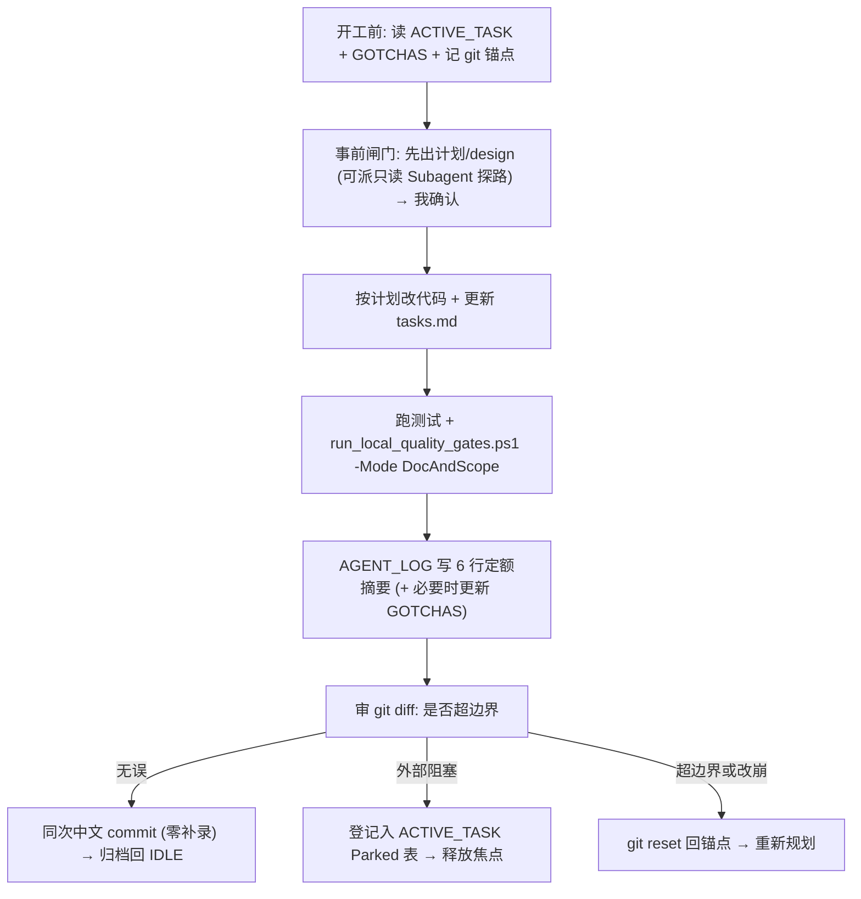

# Vibecoding Playbook · 个人 AI 协作开发手册（v2.0）

> 适用项目：Enterprise RAG QA System（及后续同类个人项目）
> 配套治理：`AGENTS.md`（Type 分级）、`openspec/`（change 生命周期）、`.ai/ACTIVE_TASK.md`（唯一活动指针与挂起表，≤25 行）、`.ai/AGENT_LOG.md`（滚动热日志，≤200 行）、`.ai/GOTCHAS.md`（避坑备忘录，≤100 行）
> 文档性质：长期沿用的"协作方法论"，与 `iteration-blueprint.md`（方向）互补——蓝图管"往哪走"，本手册管"怎么走得稳、上下文不腐化"。
> 状态日期：2026-10-21（v2.0 精益上下文升级）

## 0. 一句话原则

把人工审查点从"事后看 diff"前移到"事前审计划"，并为每个改动建立可干净回滚的 git 锚点；`ACTIVE_TASK.md` 锁住唯一写焦点，`GOTCHAS.md` 沉淀反直觉工程陷阱，`AGENT_LOG.md` 以 6 行定额滚动记录近期证据（随同次 commit 落盘，零 hash 补录），配合 `DocAndScope` 自动化门禁实现零废话、高信噪比的迭代闭环。

## 1. 核心工作流（每个 change 通用）

标准闭环分六步，**写操作严格串行（WIP = 1），只读调研允许 Subagent 并发**：

- **① 开工前置**：确认工作区干净、记录当前 commit hash（或打轻量 tag，如 `pre-W2-1`）作为回滚锚点；读取 `.ai/ACTIVE_TASK.md` 与 `.ai/GOTCHAS.md`。工具链不明时先跑本地 `Preflight`。
- **② 事前闸门（关键加固）**：先输出 **`### 💡 30秒人话导读`**（用日常比喻讲透“为什么卡住/要改什么/怎么改”），再输出"执行计划 / 待改清单"（碰哪些文件、改成什么、影响面），并明确本轮是 `Agent 提交` 还是 `用户手动提交`，经确认后才允许改代码。Type C 的事前闸门天然是 `proposal/design`（顶部含人话主旨，末尾含场景化三问 `## 决策记录`）。跨模块探路可派生只读 Subagent 并发检索，主会话只收精炼结论。
- **③ 执行**：按已确认的计划改代码，Type C 直接在 `openspec/changes/<id>/tasks.md` 勾选进度（不在多处文档重复抄写进度）。
- **④ 门禁与日志定额写入**：跑对应测试与 `scripts/run_local_quality_gates.ps1 -Mode DocAndScope`；在 `.ai/AGENT_LOG.md` 按 **6 行定额制** 追加本轮通透人话记录（若发现反直觉新坑，同步提炼 1～2 行入 `.ai/GOTCHAS.md`）。
- **⑤ 人工审 diff**：检查 `git diff` 是否超出既定边界。
- **⑥ 同次定版提交（零补录）**：Type C 验收后归档 change + spec delta 合入 baseline + `ACTIVE_TASK.md` 回 `IDLE`；按事前约定的提交责任将代码/文档与 `AGENT_LOG.md` 在**同一个中文 commit** 中提交（不再写 `Commit: pending`，也不再打后续的 hash 补录 commit）。

## 2. Type 分级速查

- **Type A（只读）**：复核、扫描、审计、教学。不建 change 目录、不改代码、不改 `ACTIVE_TASK.md`。
- **Type B（小范围维护）**：局部修复、测试隔离、构建修复、治理微调。不建 change 目录、不写 `proposal.md`，完成后通过 `DocAndScope` 门禁并在 `AGENT_LOG.md` 追加一条 6 行定额记录，同次提交。
- **Type C（重大变更）**：涉及接口/权限/持久化/状态机/spec 语义/评测门禁口径。必须走完整 OpenSpec 生命周期：建 `openspec/changes/<id>/`（`proposal/design/tasks/spec delta`）、置 `ACTIVE_TASK.md` 为 `ACTIVE`、完成经确认后归档、spec delta 合入 baseline。

## 3. 九条加固纪律

### 3.1 事前闸门：先出计划，确认后再动手

在写任何代码前，先产出可审查的计划物（Type B 是"待改清单"，Type C 是 `proposal/design`）。把关重点是"方向对不对、边界有没有越"，计划未确认禁止改代码。

### 3.2 费曼人话沟通：强制 `💡 30秒人话导读`，严禁电报黑话

Agent 在每次【事前闸门】、【完成汇报】及 `design.md` 开头，必须先写一节 **`### 💡 30秒人话导读`**，用完整句子和生活化比喻（如"秒表定太短"、"阅卷老师断网不能拿半截成绩算总分"）讲透：① 原来哪儿蠢/哪儿卡了、② 这次动手的核心逻辑是什么、③ 改完有什么直观变化。`design.md` 的决策记录与 `AGENT_LOG.md` 严禁写成删掉主谓宾的"机器电报体"（正反例见 [`design-decision-record.md`](prompt-snippets/design-decision-record.md)）。

### 3.2 git 锚点：每个 change 开工前建立可回滚点

正式改代码前，确保工作区干净并记录当前 commit hash。一旦改崩，可干净 `git reset` 回锚点，避免多个 change 的改动搅在一起。

### 3.3 禁止清单：提示词不只写"做什么"，更要写"不许碰什么"

每个任务显式列出本次不许改的边界（接口 / 依赖版本 / 受保护配置 / 无关重构），提交前确认暂存区只含目标文件。

### 3.4 验收报告事实，不承诺达标

涉及评测 / 指标的 change，验收话术统一为"跑同一评测集，报告提升/持平/回退；若回退必须解释原因，由我决定是否回滚"。禁止写"指标必须提升"，防止诱导过拟合评测集。

### 3.5 提交责任前置与单次闭环

每个任务的事前闸门明确二选一：`Agent 提交` 或 `用户手动提交`。选择 Agent 提交时，Agent 将计划内文件与 `.ai/AGENT_LOG.md` 在**同一次 commit** 中提交；选择用户手动提交时，Agent 只留改动并给中文 commit message。`push`、PR、发布和部署始终需要独立授权。

### 3.6 自动化质量门禁（用 `DocAndScope` 替代手写免责长文）

Agent 可直接运行现有项目的 Maven/npm/Python/PowerShell 本地验证命令。每次文件改动收尾时，固定运行：

```powershell
powershell -NoProfile -ExecutionPolicy Bypass -File scripts/run_local_quality_gates.ps1 -Mode DocAndScope
```

该模式自动完成 `git diff --check`、受保护路径检查、改动 Markdown 相对链接校验及 `AGENT_LOG.md` 行数水位检查。在日志和回复中直接记录 `[doc-scope] PASS` 即可，禁止再用大段自然语言罗列"检查了多少个链接、未改哪些目录"。

### 3.7 滚动热日志（6 行定额）与 `GOTCHAS.md` 冷热分离

- **`.ai/AGENT_LOG.md`（滚动热窗口，≤200 行）**：只保留最近约 10 次任务的执行摘要，方便新会话直接读取延续上下文。超过 200 行或阶段收口时，将旧记录原样迁入 `.ai/logs/YYYY-MM-<stage>.md` 冷归档。
- **单条 6 行定额**：只记 ① 标题、② 改动与一句大白话（改前坏事 → 改后不同 + 决策号 `D*`）、③ 核心测试与 `DocAndScope` 门禁结果（含跳过原因）、④ 新增踩坑与剩余风险。
- **`.ai/GOTCHAS.md`（避坑备忘录，≤100 行）**：当排障发现反直觉陷阱（如沙箱权限死循环、冻结审计 SHA 漂移）时，提炼 1～2 行按模块归入 `GOTCHAS.md`，实现真正的跨会话经验传承。

### 3.8 写单焦点 + 读并发 + `Parked` 挂起槽位

- **写操作单焦点**：同一工作区同一时间最多 1 个 `ACTIVE` 写任务。
- **只读 Subagent 并发**：调研、搜代码、查长日志时，鼓励派生只读 Subagent 在独立上下文执行，只把结论传回主会话，防止主窗口 Context Rot。
- **`Parked` 挂起表**：若当前任务遇到外部 API 限流/超时或等待人工真机验收，经确认后将其登记入 `.ai/ACTIVE_TASK.md` 的 `Parked` 表格（1 行 1 项），即可干净释放 `ACTIVE` 指针推进下一任务。

## 4. Bug 处理规程

任何 bug 修复都遵循：**先复现 → 再定位根因 → 最后才改**，尽量补一条回归测试，并将反直觉根因提炼 1～2 行写入 `.ai/GOTCHAS.md`：

- **当前 change 引入的 bug**：小问题在当前 change 内定位修复；大问题直接 `git reset` 回开工锚点重新规划。
- **已归档历史 change 遗留的 bug**：不回改旧 archive。小的当 Type B，涉及接口 / spec 语义的当 Type C 新立项。

## 5. 收尾与异常处理节奏图



## 6. 可复用提示词模板

### 6.1 Type A · 只读复核 / 扫描

- 声明本轮为 Type A 只读；禁止修改任何文件、禁止跑外部调用。
- 跨文件检索可派生只读 Subagent；所有关键结论附文件路径 + 行号证据，并对能力按 `confirmed / partial / planned / out_of_scope / unknown` 分类。

### 6.2 Type B · 小范围维护执行

- 第一步（事前闸门）：读 `ACTIVE_TASK.md` 与 `GOTCHAS.md`；输出"待改清单"（文件 + 现状 + 建议改法）并确认提交方式（`Agent 提交` / `用户手动提交`）。
- 第二步：按清单修改，不碰无关模块。
- 第三步：跑聚焦测试与 `run_local_quality_gates.ps1 -Mode DocAndScope`；在 `.ai/AGENT_LOG.md` 追加一条 6 行定额记录（若有新陷阱同步更新 `.ai/GOTCHAS.md`）；按约定在同一次 commit 中完成中文提交。

### 6.3 Type C · 重大变更（分阶段）

- **阶段一（proposal/design 事前闸门）**：生成 `openspec/changes/<id>/`（含三行式 `## 决策记录`），将 `.ai/ACTIVE_TASK.md` 指向该 change（保持 ≤25 行）；涉及外部调用时披露预算/模型/出站并获授权。
- **阶段二（实现切片）**：记录 git 锚点，按切片改代码并勾选 `tasks.md`；跑测试与 `DocAndScope` 门禁，在 `AGENT_LOG.md` 写 6 行定额记录，同次 commit 落盘。
- **阶段三（验收归档）**：确认后移入 `openspec/changes/archive/YYYY-MM-DD-<id>/`、合入 baseline spec、`ACTIVE_TASK.md` 回 `IDLE`，同次 commit 收口（无需二次补录 hash）。

## 7. 与治理文件的关系

- **`AGENTS.md`**：Type 分级与协作硬规则（冲突时以它为准）。
- **`.ai/ACTIVE_TASK.md`**：唯一活动写指针与 `Parked` 挂起表（≤25 行，不重复抄写 `tasks.md`）。
- **`.ai/GOTCHAS.md`**：跨会话反直觉工程陷阱备忘录（≤100 行）。
- **`.ai/AGENT_LOG.md`**：近期执行证据滚动热窗口（≤200 行，6 行定额/条，历史分片封存于 `.ai/logs/`）。
- **`openspec/`**：Type C 的生命周期与 `openspec/specs/` 长期契约。
- **`iteration-blueprint.md` & `technical-debt.md`**：长期演进方向与待闭环债务账本。
